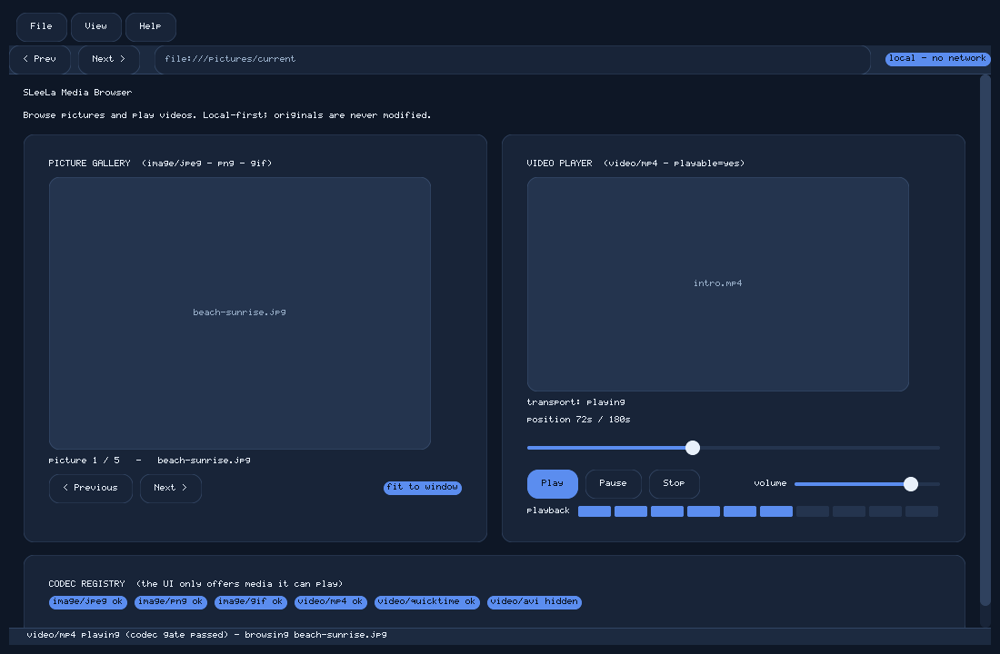

# gui — SLeeLa Media Browser

A standalone native SleelaUI desktop application for **browsing pictures and
playing videos**, written in SLeeLa (syntax 2.9) and driven by the SLeeLa VM's
`ui*` built-ins. It is a general media-application shell with a File menu and
the usual media controls, and it matches the look and feel of the project's
other SleelaUI windows (`src/ui/ImagingWindow.sleela`) and the reference
`gui-dual-media-studio` demo in the SLeeLa toolkit.



*A real render of `MediaBrowser.sleela` by the SleelaUI software rasterizer with
no display server — produced headlessly from `screenshot-mediabrowser.sleela`,
not a mockup.*

## Files

- `MediaBrowser.sleela` — the interactive application. A `MediaBrowser` class
  that opens a native window and runs an event loop.
- `screenshot-mediabrowser.sleela` — a capture driver that builds the identical
  widget tree with pre-filled state and pumps a few non-blocking frames so a
  display-less run can render a real screenshot. Mirrors the repo's
  `tests/screenshot-window.sleela`.

## Features

- **Menu bar**: File (Open Picture / Open Folder / Media Information / Quit),
  View (Picture Gallery / Video Player), and Help (Media Guide / About),
  implemented as a horizontal button strip with collapsible dropdown panels.
- **Navigation header**: Prev / Next, a location field, and a `local - no
  network` badge.
- **Picture gallery**: an image canvas with a paging caption and Previous /
  Next controls that cycle a small demo set.
- **Video player**: a video canvas with full transport — Play / Pause / Stop, a
  seek slider, a volume slider, and a playback level bar.
- **Codec registry**: badges showing which media types the UI will offer; an
  unplayable type is shown disabled. The UI never offers media it cannot play.

The browser owns no filesystem-mutating capability. Consistent with the
project's security posture there is no network, telemetry, key upload, database
logging, or source deletion; originals are never modified.

## Run it

Requires the source-built `sleela` compiler (syntax 2.9) from
[mearvk/SLeeLa](https://github.com/mearvk/SLeeLa) and a native display
(X11 / Cocoa / Win32). With no display it reports that and exits cleanly.

```sh
SLEELA=/path/to/SLeeLa
SLEELA_HOME=$SLEELA $SLEELA/impl/build/sleela run gui/MediaBrowser.sleela
```

## Reproduce the screenshot (headless)

The screenshot is a real software-rasterizer render produced with no display,
using the one-time `SLEELA_UI_DUMP` capture hook described in
[`../docs/SCREENSHOT.md`](../docs/SCREENSHOT.md). Build the compiler with the
headless SleelaUI backend, then:

```sh
SLEELA_UI_DUMP=gui/mediabrowser.ppm SLEELA_HOME=$SLEELA \
  $SLEELA/impl/build/sleela run gui/screenshot-mediabrowser.sleela
python3 tests/ppm_to_png.py gui/mediabrowser.ppm docs/images/media-browser.png
```
